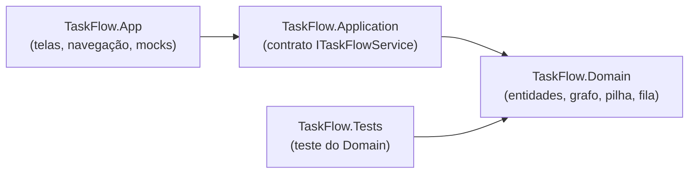

# TaskFlow

**Gerenciador de projetos e tarefas estilo Kanban, com controle financeiro pessoal e dependências entre tarefas.**

Aplicação de console em **C# / .NET 8**, desenvolvida em dupla na faculdade (Análise e Desenvolvimento de Sistemas).

| Pessoa                 | Responsabilidade           | Projetos                                                    |
| ---------------------- | -------------------------- | ----------------------------------------------------------- |
| **Pessoa A** (Eduardo) | Core / Back end            | `TaskFlow.Domain`, `TaskFlow.Application`, `TaskFlow.Tests` |
| **Pessoa B**           | Interface / UI / Navegação | `TaskFlow.App`                                              |

---

## ⚠️ Leia primeiro: o que mudou na estrutura do projeto

A branch `refactor/organizar-estrutura` reorganiza o repositório.

> **Nenhuma regra de negócio, tela ou assinatura de método foi alterada.**
> Mudaram apenas **onde os arquivos estão** e **quem depende de quem**.

### Resumo em 30 segundos

- O código agora fica em `src/`, os testes em `tests/` e a documentação em `docs/`.
- Existe **uma solution só**: `TaskFlow.sln`, na raiz.
- Todos os projetos usam **.NET 8** (antes, `Domain` e `Tests` estavam em `net10.0`).
- Foi criado o projeto **`TaskFlow.Application`**, e o contrato **`ITaskFlowService`** saiu do `TaskFlow.App` e foi para lá.
- Pastas geradas pelo compilador (`bin/` e `obj/`) **não são mais versionadas**; há um `.gitignore`.
- A pasta `TaskFlow/` aninhada, que era uma cópia duplicada do projeto, foi removida.

### Onde cada coisa foi parar (antes → depois)

| Antes                                       | Depois                                         |
| ------------------------------------------- | ---------------------------------------------- |
| `BackendCSharp/TaskFlow.Domain/`            | `src/TaskFlow.Domain/`                         |
| `BackendCSharp/TaskFlow.Tests/`             | `tests/TaskFlow.Tests/`                        |
| `TaskFlow.App/`                             | `src/TaskFlow.App/`                            |
| `TaskFlow.App/Services/ITaskFlowService.cs` | `src/TaskFlow.Application/ITaskFlowService.cs` |
| `BackendCSharp/TaskFlow.slnx`               | removido (usar `TaskFlow.sln`)                 |
| `Apresentacao_Web/`                         | `docs/Apresentacao_Web/`                       |
| `CHECKLIST_FASE1_PessoaB.md`                | `docs/CHECKLIST_FASE1_PessoaB.md`              |
| `README_COMO_EXECUTAR.md`                   | substituído por este README                    |
| `TaskFlow/` (cópia duplicada)               | removida                                       |

### A regra que organiza tudo: as setas apontam para o centro

As regras do negócio ficam no **centro**. Os detalhes (tela, banco, web) ficam nas **bordas** e dependem do centro, **nunca o contrário**. Assim, trocar o console por uma API, ou o SQLite por outro banco, não mexe nas regras.



| Projeto                | Papel                                                                                            | Referencia    | Responsável                                  |
| ---------------------- | ------------------------------------------------------------------------------------------------ | ------------- | -------------------------------------------- |
| `TaskFlow.Domain`      | Entidades, enums e estruturas de dados (grafo, pilha, fila, árvore). **Não depende de ninguém.** | nenhum        | Pessoa A                                     |
| `TaskFlow.Application` | Contratos (`ITaskFlowService`) e, futuramente, serviços e interfaces de repositório              | `Domain`      | Pessoa A (contrato combinado com a Pessoa B) |
| `TaskFlow.App`         | Interface de console: `Views/`, `Navigation/`, `MockServices/`                                   | `Application` | Pessoa B                                     |
| `TaskFlow.Tests`       | Console de teste das estruturas do Domain                                                        | `Domain`      | Pessoa A                                     |

**Por que o `ITaskFlowService` mudou de lugar?** O contrato é o acordo entre o back end e a interface. Se ele mora dentro da tela, o back end passa a precisar da interface para enxergá-lo, e a dependência fica invertida. No `Application`, ele pertence ao centro, e a tela é apenas um dos "aparelhos" que se plugam nele.

### O que mudou no código (só três linhas)

```diff
 // src/TaskFlow.Application/ITaskFlowService.cs
-namespace TaskFlow.App.Services
+namespace TaskFlow.Application

 // src/TaskFlow.App/MockServices/TaskFlowMockService.cs
-using TaskFlow.App.Services;
+using TaskFlow.Application;

 // src/TaskFlow.App/TaskFlow.App.csproj
+<ItemGroup>
+  <ProjectReference Include="..\TaskFlow.Application\TaskFlow.Application.csproj" />
+</ItemGroup>
```

O contrato continua com os mesmos seis métodos, e o `TaskFlowMockService` continua no `TaskFlow.App`.

### O que ficou igual

- Todas as `Views/`, o `MenuNavigator` e o `Program.cs`.
- As estruturas de dados e as classes do `Domain`.
- Os métodos do `ITaskFlowService` e o comportamento do menu.

### O que a Pessoa B precisa fazer

1. **Antes do merge:** faça commit e `push` de qualquer trabalho em andamento no `TaskFlow.App`, para ele não ficar preso na estrutura antiga.
2. **Depois do merge:** atualize a sua cópia.
   ```powershell
   git checkout main
   git pull
   ```
3. **Pastas antigas sobrando.** Se sobrarem `BackendCSharp/`, `TaskFlow.App/` na raiz ou a pasta `TaskFlow/` aninhada, elas devem conter só arquivos gerados (`bin/` e `obj/`). Podem ser apagadas.
4. **Abra `TaskFlow.sln`** (o `.slnx` não existe mais) e compile:
   ```powershell
   dotnet build TaskFlow.sln
   ```
5. **Editor com erros vermelhos que o build não confirma?** É cache antigo do editor. No VS Code, use `Ctrl + Shift + P` e **Developer: Reload Window**. No Visual Studio, feche e reabra a solution.
6. **Trabalho em outra branch?** Traga as mudanças com `git merge main`. O Git acompanha arquivos movidos (renames) e costuma juntar as suas edições nos novos caminhos.
7. Ao usar o contrato, o `using` agora é `using TaskFlow.Application;`.

### Como revisar este PR (commit a commit)

Cada commit tem **uma** mudança, para facilitar a revisão e a volta atrás.

| #   | Commit    | O que faz                                                                                        |
| --- | --------- | ------------------------------------------------------------------------------------------------ |
| 1   | `b09a025` | Adiciona `.gitignore` para projetos .NET                                                         |
| 2   | `50e2d1c` | Remove `bin/` e `obj/` do versionamento (116 arquivos gerados; nenhum código)                    |
| 3   | `ca64b8f` | Remove a cópia duplicada do projeto (pasta `TaskFlow/` aninhada; arquivos idênticos aos da raiz) |
| 4   | `41ed782` | Padroniza `Domain` e `Tests` em `net8.0`                                                         |
| 5   | `fd44271` | Move projetos para `src/` e `tests/` e unifica a solution                                        |
| 6   | `f8faf4c` | Move a documentação para `docs/`                                                                 |
| 7   | `b472088` | Cria o projeto `TaskFlow.Application`, referenciando o `Domain`                                  |
| 8   | `d5af4bb` | Move o `ITaskFlowService` para a camada `Application`                                            |
| 9   | (este)    | Substitui os READMEs por este README unificado                                                   |

Nos commits 5, 6 e 8, o Git registra os arquivos como **renomeados** (`R`), então o histórico de cada arquivo é preservado (`git log --follow <arquivo>`).

---

## Visão geral

O **TaskFlow** é um sistema unificado de gestão de projetos e finanças pessoais, centrado no conceito de **Tarefa**:

- Quadro **Kanban** com as colunas _A Fazer_, _Em Andamento_, _Concluída_ e _Bloqueada_.
- **Dependências entre tarefas**, com detecção de ciclo, tarefas prontas para iniciar e ordenação topológica.
- **Fila de prioridade** (prioridade + prazo) para decidir o que executar primeiro.
- **Histórico e desfazer (Undo)** com pilha.
- **Controle financeiro pessoal**: contas, status e saldo restante.

## Estrutura de pastas

```text
TaskFlow/
├── TaskFlow.sln
├── README.md
├── .gitignore
│
├── src/
│   ├── TaskFlow.Domain/            # Entidades, enums e estruturas de dados
│   │   ├── Dependencia.cs
│   │   ├── FilaPrioridade.cs
│   │   ├── GrafoDependencias.cs
│   │   ├── HistoricoAcao.cs
│   │   ├── PilhaUndo.cs
│   │   ├── Projeto.cs
│   │   ├── StatusFinanceiro.cs
│   │   ├── StatusTarefa.cs
│   │   ├── Tarefa.cs
│   │   ├── TarefaFinanceira.cs
│   │   └── TipoFinanceiro.cs
│   │
│   ├── TaskFlow.Application/       # Contratos (ITaskFlowService)
│   │   └── ITaskFlowService.cs
│   │
│   └── TaskFlow.App/               # Aplicação de console (interface)
│       ├── Program.cs
│       ├── Navigation/
│       │   └── MenuNavigator.cs    # Loop principal e navegação
│       ├── Views/
│       │   ├── DashboardView.cs
│       │   ├── KanbanView.cs
│       │   ├── FinanceiroView.cs
│       │   └── GrafoDependenciasView.cs
│       └── MockServices/
│           └── TaskFlowMockService.cs   # Simulação do back end
│
├── tests/
│   └── TaskFlow.Tests/             # Console de teste do Domain
│       └── Program.cs
│
├── docs/
│   ├── CHECKLIST_FASE1_PessoaB.md
│   └── Apresentacao_Web/           # Painel visual interativo (HTML/CSS)
│       ├── index.html
│       ├── checklist.html
│       ├── estrutura.html
│       ├── taskflow_app.html
│       └── taskflow_docs.html
│
└── AutomacaoPython/                # Scripts de automação (a criar)
```

## Como executar

**Requisito:** [.NET SDK 8](https://dotnet.microsoft.com/download) ou superior. Execute os comandos na pasta raiz do repositório.

**Compilar tudo**

```powershell
dotnet build TaskFlow.sln
```

**Rodar a aplicação (menu de console)**

```powershell
dotnet run --project src\TaskFlow.App\TaskFlow.App.csproj
```

Ou, no Visual Studio / VS Code: abra `TaskFlow.sln`, defina `TaskFlow.App` como projeto de inicialização e pressione `F5` ou `Ctrl + F5`.

**Rodar os teste do Domain**

```powershell
dotnet run --project tests\TaskFlow.Tests
```

Mostra a demonstração do grafo e, em seguida, os testes automáticos (`[PASSOU]` / `[FALHOU]`). O código de saída é `0` quando todos passam e `1` quando algum falha.

**Ver a apresentação web**

Abra `docs\Apresentacao_Web\index.html` no navegador, ou use um servidor local:

```powershell
cd docs\Apresentacao_Web
python -m http.server 8000
```

Acesse `http://localhost:8000`.

## Estado atual do projeto

### Estruturas de dados e tecnologias

| Estrutura / Tecnologia                | Status         | Uso principal                  |
| ------------------------------------- | -------------- | ------------------------------ |
| Grafo (`GrafoDependencias`)           | Feito          | Dependências entre tarefas     |
| Pilha (`PilhaUndo`)                   | Feito          | Undo / histórico               |
| Fila de prioridade (`FilaPrioridade`) | Feito          | Ordenar tarefas por prioridade |
| Lista                                 | Feito          | Armazenamento geral            |
| Árvore                                | Feito (básico) | Subtarefas                     |
| SQLite                                | Falta          | Persistência dos dados         |
| Entity Framework / Dapper             | Falta          | Acesso ao banco                |
| Python                                | Falta          | Automação e notificações       |

### Back end (Pessoa A)

- **Feito:** classes `Projeto`, `Tarefa`, `TarefaFinanceira`, `HistoricoAcao`, `Dependencia`; enums `StatusTarefa`, `TipoFinanceiro`, `StatusFinanceiro`; as estruturas de dados acima; projeto de teste em console.
- **Falta:** persistência, serviços na camada `Application`, CRUD completo, cálculos financeiros (salário livre, contas atrasadas etc.), integração real com a interface no lugar dos mocks, métodos extras do grafo (remover dependência, visualização em texto), scripts Python e testes mais completos.

A base de modelagem e estruturas de dados está pronta (~30%).

### Interface (Pessoa B) — Fase 1

- **1.1 Configuração e arquitetura:** projeto `TaskFlow.App` criado, com pastas `Views/`, `Navigation/` e `MockServices/`.
- **1.2 Menu principal e navegação:** loop estável, cabeçalho com estado do sistema e as opções _Dashboard Geral_, _Gestão de Projetos e Tarefas (Kanban)_, _Área Financeira Pessoal_, _Fila de Execução (Prioridades)_, _Histórico e Desfazer (Undo)_ e _Sair_.
- **1.3 Esqueleto das telas:** Dashboard, Projetos, Kanban, Financeiro e Dependências.
- **1.4 Contrato de integração:** interface `ITaskFlowService` e feedbacks visuais de erro amigáveis.

> Os documentos em `docs/` (checklist e apresentação web) registram a Fase 1 **na estrutura da época** e usam os caminhos antigos. São um histórico do que foi entregue.

## Problemas conhecidos

1. **O `ITaskFlowService` ainda não é usado pelas telas.** Hoje só o `TaskFlowMockService` o implementa; nenhuma `View` o chama. Além disso, os métodos são `void` e o mock imprime no console. Para a integração real, o contrato precisará **devolver dados** (por exemplo, listas de projetos) para as `Views` exibirem. Isso é uma **mudança de contrato**, a ser combinada entre a Pessoa A e a Pessoa B.
2. **Documentação da Fase 1 com caminhos antigos** (veja a observação acima).

## Trabalhando em dupla com Git

- **Combine o contrato (`ITaskFlowService`) antes de implementar.** Quem implementa o back end e quem consome na interface trabalham sobre o mesmo acordo; a interface usa o mock até o real ficar pronto.
- **Cada um trabalha em uma branch** e junta via **pull request**, com o outro revisando.
- **Mudou o contrato?** Avise e atualizem juntos. Mudança silenciosa na interface é a principal causa de integração quebrada.
- **Refatoração e funcionalidade nova em commits separados.** Para mover arquivos preservando o histórico, use `git mv`.
